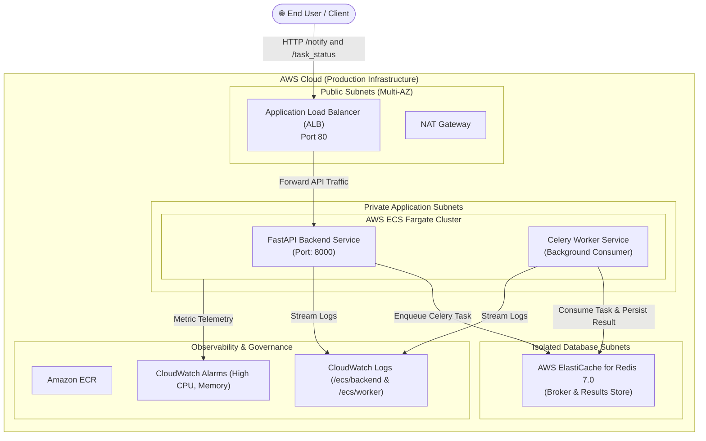

# DevOps Assessment: Containerized Notification & Task Engine

[](https://github.com/Krutika-02/devops-assignment/actions/workflows/ci-cd.yml)
[](https://fastapi.tiangolo.com)
[](https://docs.celeryq.dev)
[](https://redis.io)
[](https://www.docker.com/)
[](https://aws.amazon.com/cdk/)

A production-grade, containerized asynchronous notification service built with **FastAPI**, **Celery**, and **Redis**, fully provisioned on **AWS ECS Fargate** and **AWS ElastiCache** using **AWS CDK (Python)**, with zero-downtime **GitHub Actions CI/CD**.

---

## 🏗️ System Architecture



---

## 📁 Repository Structure

```
.
├── .github/
│   └── workflows/
│       └── ci-cd.yml             # 4-stage automated CI/CD pipeline
├── backend/
│   ├── Dockerfile                # Production non-root container image
│   ├── main.py                   # FastAPI REST API (CORS, health, status)
│   └── worker.py                 # Celery task definitions & logging
├── cdk/                          # AWS CDK (Python) Infrastructure as Code
│   ├── app.py                    # CDK App entry point
│   ├── cdk.json                  # CDK configuration
│   ├── requirements.txt          # CDK dependencies
│   └── stacks/
│       ├── network_stack.py      # Multi-AZ VPC, subnets, security groups
│       ├── database_stack.py     # AWS ElastiCache for Redis
│       ├── ecs_stack.py          # ECS Fargate, ECR, ALB, Task Defs
│       └── monitoring_stack.py   # CloudWatch Alarms & Dashboard
├── frontend/
│   ├── Dockerfile                # Nginx Alpine container
│   ├── index.html                # Modern single-page app with live polling
│   └── nginx.conf                # Reverse proxy config for API routes
├── tests/
│   ├── test_api.py               # Unit & integration tests for FastAPI
│   └── test_worker.py            # Unit tests for Celery background tasks
├── .dockerignore
├── .env.example                  # Environment configuration template
├── architecture.md               # Detailed architecture & sequence diagrams
├── docker-compose.yml            # Multi-container local orchestration
├── instructions.md               # Step-by-step developer manual
├── journey.md                    # Engineering post-mortem & decisions
└── requirements.txt              # Application Python dependencies
```

---

## ⚡ Quickstart: Run Locally with Docker Compose

Running the entire stack requires only one command:

```bash
# 1. Clone the repository
git clone https://github.com/Krutika-02/devops-assignment.git
cd devops-assignment

# 2. Start the full application stack
docker compose up --build -d

# 3. Verify running containers
docker compose ps
```

### Access Points:
- 🖥️ **Frontend UI:** [http://localhost:3000](http://localhost:3000)
- 🔌 **FastAPI Root & Status:** [http://localhost:8000/](http://localhost:8000/)
- 📖 **Interactive Swagger Docs:** [http://localhost:8000/docs](http://localhost:8000/docs)
- 🩺 **Health Check:** [http://localhost:8000/health](http://localhost:8000/health)

---

## 🛠️ Developer Commands & Debugging

| Command | Description |
|---------|-------------|
| `docker compose logs -f` | Follow logs from all running services |
| `docker compose logs -f backend` | Stream FastAPI backend logs |
| `docker compose logs -f worker` | Stream Celery worker logs |
| `docker compose exec redis redis-cli ping` | Check Redis health (`PONG`) |
| `docker compose exec worker cat /app/logs/log_celery.txt` | View worker-generated file logs |
| `docker compose down -v` | Stop containers and wipe volumes |

For full details, see [instructions.md](instructions.md).

---

## 🧪 Testing the API via CLI

### 1. Trigger Notification Task
```bash
curl -X POST "http://localhost:8000/notify/?email=dev@example.com"
```
```json
{
  "message": "Email will be sent to dev@example.com",
  "task_id": "993f41ae-7f97-40c2-90f7-5b6d193d5f5b",
  "status": "queued"
}
```

### 2. Poll Task Status (In Progress)
```bash
curl "http://localhost:8000/task_status/993f41ae-7f97-40c2-90f7-5b6d193d5f5b"
```
```json
{
  "task_id": "993f41ae-7f97-40c2-90f7-5b6d193d5f5b",
  "status": "in progress"
}
```

### 3. Check Status (Completed after ~10s)
```bash
curl "http://localhost:8000/task_status/993f41ae-7f97-40c2-90f7-5b6d193d5f5b"
```
```json
{
  "task_id": "993f41ae-7f97-40c2-90f7-5b6d193d5f5b",
  "status": "completed",
  "result": "Task completed: Notification sent to dev@example.com"
}
```

---

## ☁️ Cloud Infrastructure as Code (AWS CDK)

The cloud infrastructure is defined using modular Python CDK constructs under [`cdk/`](cdk/):

```bash
cd cdk
pip install -r requirements.txt

# Synthesize CloudFormation templates
cdk synth

# Deploy all stacks to AWS
cdk deploy --all
```

### CDK Stacks:
1. **NetworkStack**: Multi-AZ VPC, Public & Private Subnets, NAT Gateway, Security Groups.
2. **DatabaseStack**: AWS Managed ElastiCache for Redis 7.0 in isolated subnets with encryption at rest.
3. **EcsStack**: AWS ECS Fargate Cluster, ECR repositories, Task Definitions, and ALB with path routing.
4. **MonitoringStack**: CloudWatch Metric Alarms (CPU/Memory) and operational dashboard.

---

## 🔄 CI/CD Pipeline (GitHub Actions)

The repository includes a 4-stage workflow in [`.github/workflows/ci-cd.yml`](.github/workflows/ci-cd.yml):
1. **Test**: Spins up an ephemeral Redis container and executes `pytest tests -v` (7 tests, 100% pass).
2. **Build**: Builds backend and frontend Docker images; validates Docker Compose healthcheck.
3. **CDK Validation**: Runs `cdk synth` dry-run to validate CloudFormation templates.
4. **Deploy**: Automatically pushes images to Amazon ECR and updates the AWS ECS Fargate services upon push to `main`.

---

## 🎥 Video Walkthrough

A 3–5 minute video walkthrough explaining the architecture, local containerization, AWS CDK infrastructure, and CI/CD pipeline:
- **Loom Walkthrough Link:** `[Insert your recorded Loom link here]`

---

## 📬 Submission

- **Repository:** [https://github.com/Krutika-02/devops-assignment](https://github.com/Krutika-02/devops-assignment)
- **Recipient:** `advaid@superclaims.ai`
- **Subject:** `DevOps Assessment Assignment`
