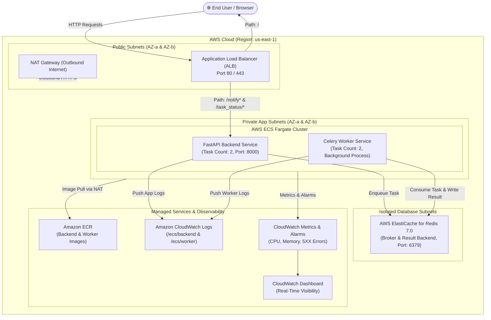
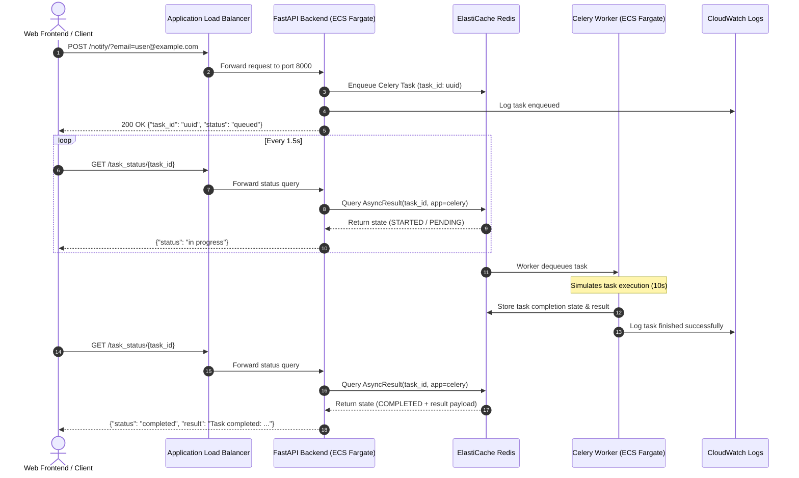

# Cloud Architecture & Infrastructure Design

This document details the production cloud architecture for the containerized Notification Engine deployed on AWS using AWS CDK (Python).

---

## 1. High-Level Architecture Diagram

---

## 2. Component Breakdown

| Layer | Service | Purpose | Managed Service Justification |
|-------|---------|---------|-------------------------------|
| **Ingress** | AWS Application Load Balancer (ALB) | SSL termination, health checking, traffic distribution across AZs | Zero server maintenance, automated scaling, seamless integration with ECS IP targets. |
| **Compute** | AWS ECS on AWS Fargate | Runs FastAPI backend and Celery workers | Serverless container orchestration. Eliminates EC2 patching, OS management, and capacity planning. |
| **Message Broker** | AWS ElastiCache for Redis 7.0 | In-memory message broker & task status result backend | Fully managed, automated failure detection, multi-AZ replication, in-transit & at-rest encryption. |
| **Registry** | Amazon Elastic Container Registry (ECR) | Stores versioned Docker images | Built-in vulnerability scanning on push, lifecycle policies to prune stale images. |
| **Observability** | Amazon CloudWatch | Centralized logging, alarms, and dashboards | Native log forwarding via `awslogs` driver, real-time alerting on container failure or CPU spikes. |
| **Network** | Amazon VPC | Multi-AZ network isolation across public, private, and database subnets | Defense-in-depth isolation; Redis is physically unreachable from the public internet. |

---

## 3. Request & Task Execution Lifecycle

---

## 4. Security & Network Boundaries

1. **Public Internet -> ALB**: Only Port 80/443 open to `0.0.0.0/0`.
2. **ALB -> ECS Backend**: Port 8000 strictly restricted to incoming traffic from the ALB Security Group.
3. **ECS Backend / Worker -> Redis**: Port 6379 strictly restricted to the ECS Security Group. Direct access from the internet or other subnets is blocked at the VPC routing and Security Group layers.
4. **Container Security**: All containers run with non-root user `appuser` (UID 1000).
